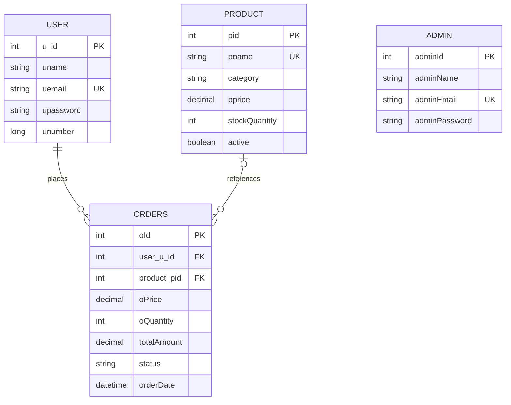

# FoodFrenzy

FoodFrenzy is a restaurant menu, ordering, and management application built as a full-stack college project. Customers can register, browse a live menu, place orders, and track order progress. Administrators can manage menu items and stock, customer accounts, team access, and order status.

## Features

- Customer registration and sign-in with BCrypt password hashing.
- Contact form that emails website enquiries to the configured inbox and sets the visitor's address as Reply-To.
- Session-based customer and administrator roles, protected routes, and CSRF protection for forms.
- Database-backed menu with categories, descriptions, images, prices, and stock counts.
- Searchable menu and customer order history.
- Server-calculated order totals and stock checks inside a database transaction.
- Order status workflow: `PLACED -> CONFIRMED -> PREPARING -> READY -> COMPLETED`; an order can be cancelled before it is ready.
- Admin dashboard for menu, customer, administrator, stock, and order management.
- Seeded starter menu and a first administrator created from private environment variables.
- MySQL schema migration, a production profile, Docker packaging, and a health endpoint.
- Responsive Thymeleaf pages with project-owned CSS and local food imagery.

## Technology

- Java 17
- Spring Boot 4.1.2, Spring MVC, Spring Security, Spring Data JPA, Hibernate
- Thymeleaf, HTML, CSS
- MySQL
- Maven Wrapper

## Run locally

1. Install JDK 17 and start MySQL 8. Create or use the `foodfrenzy` database.
2. In PowerShell, set your local database details and choose a private first-admin password. Run these commands in the same terminal:

   ```powershell
   $env:DB_USERNAME = "root"
   $secureDbPassword = Read-Host "MySQL password" -AsSecureString
   $env:DB_PASSWORD = [System.Net.NetworkCredential]::new("", $secureDbPassword).Password
   $env:DEMO_ADMIN_EMAIL = "admin@foodfrenzy.local"
   $secureAdminPassword = Read-Host "New admin password" -AsSecureString
   $env:DEMO_ADMIN_PASSWORD = [System.Net.NetworkCredential]::new("", $secureAdminPassword).Password
   .\mvnw.cmd spring-boot:run
   ```

3. Open [http://localhost:8081](http://localhost:8081).

Local startup uses the `local` profile and Hibernate schema updates for compatibility with an existing project database. On an empty local database it creates the schema and inserts the starter menu. If the database has no administrator, `DEMO_ADMIN_EMAIL` and `DEMO_ADMIN_PASSWORD` are required. Existing administrator passwords are never reset from environment variables.

Email is optional for starting the app. Contact messages are sent to `CONTACT_EMAIL` (default `t04829970@gmail.com`). Gmail SMTP uses `MAIL_USERNAME` and `MAIL_PASSWORD`; `MAIL_HOST` and `MAIL_PORT` default to `smtp.gmail.com` and `587`. Without valid SMTP settings the contact form explains that sending failed and provides the direct email address. Keep the Gmail app password out of source control.

## Run with Docker Compose

Docker Compose starts the app and a MySQL 8.4 database with a persistent volume. Copy `.env.example` to `.env`, replace every `replace-with-...` value with a private random password, then run:

```powershell
docker compose up --build
```

Open [http://localhost:8081](http://localhost:8081). The health check is available at [http://localhost:8081/actuator/health](http://localhost:8081/actuator/health). For a public HTTPS deployment, set `SESSION_COOKIE_SECURE=true` and terminate TLS at the hosting provider or reverse proxy. Store environment values in the provider's secret settings rather than uploading `.env`.

The `prod` profile requires `DB_URL`, `DB_USERNAME`, `DB_PASSWORD`, `DEMO_ADMIN_EMAIL`, and `DEMO_ADMIN_PASSWORD`. It validates the database schema after Flyway runs and refuses to use Hibernate's automatic schema update. The first migration is intended for a fresh deployment database; take a backup and plan a baseline migration before connecting a legacy database with existing data.

## Deploy on Railway

The repository includes a root-level `Dockerfile`, which Railway detects automatically. For a first deployment:

1. Push this project to GitHub, create a Railway project from that repository, and let the first build use the detected `Dockerfile`.
2. In the Railway project, add a **MySQL** database service. Keep it private; the web service connects over Railway's private network.
3. In the web service's **Variables** tab, add the variables below. If your database service has a name other than `MySQL`, replace `MySQL` in the three reference expressions with its exact Railway service name.

   | Variable | Value |
   | --- | --- |
   | `SPRING_PROFILES_ACTIVE` | `prod` |
   | `DB_URL` | `jdbc:mysql://${{MySQL.MYSQLHOST}}:${{MySQL.MYSQLPORT}}/${{MySQL.MYSQLDATABASE}}?useSSL=false&allowPublicKeyRetrieval=true&serverTimezone=UTC` |
   | `DB_USERNAME` | `${{MySQL.MYSQLUSER}}` |
   | `DB_PASSWORD` | `${{MySQL.MYSQLPASSWORD}}` |
   | `DEMO_ADMIN_EMAIL` | Your chosen administrator email |
   | `DEMO_ADMIN_PASSWORD` | A new, unique administrator password |
   | `CONTACT_EMAIL` | `t04829970@gmail.com` |
   | `SESSION_COOKIE_SECURE` | `true` |

   Set the administrator password directly in Railway's private Variables tab. Do not put it in GitHub or share it in chat. Railway's `${{Service.VARIABLE}}` syntax creates references to the MySQL service's generated connection settings. Do not set `PORT`; Railway supplies it, and the app listens on that value.

4. In the web service's **Settings → Deploy**, set the healthcheck path to `/actuator/health`. In **Settings → Networking**, generate a public domain for the web service. Railway's injected `PORT` is used by the app; do not hard-code a public port.
5. Deploy and check the deployment logs. After it becomes healthy, open the generated domain and create a customer account. Sign in with the administrator email/password you set above.
6. If you want the contact form to send messages, also set `MAIL_USERNAME` to the Gmail account that sends mail and `MAIL_PASSWORD` to that account's Google App Password. These are optional for running the website. The recipient remains `CONTACT_EMAIL`.

The first production database must be a **fresh Railway MySQL database** so Flyway can create the tables and the app can seed its starter menu and first administrator. Your local MySQL data does not move to Railway automatically. Do not connect Railway to the existing local database or import `.env.example`; that file contains local Docker Compose values. If you need to preserve existing records, back them up and plan a Flyway baseline/import before deploying them.

Enable database backups in Railway after the first deploy. See Railway's [MySQL guide](https://docs.railway.com/databases/mysql), [Dockerfile guide](https://docs.railway.com/builds/dockerfiles), and [healthcheck guide](https://docs.railway.com/deployments/healthchecks).

## Admin account

No shared administrator password is shipped in the project. On an empty database, the first administrator is created from `DEMO_ADMIN_EMAIL` and `DEMO_ADMIN_PASSWORD`. Set these before the first app start and keep them private. Changing the environment variables later does not modify an existing admin account. Customers create their own accounts from the **Create a customer account** link on the sign-in page.

## Build and tests

Run the complete local check with:

```powershell
.\mvnw.cmd clean verify
```

Tests use an isolated in-memory H2 database and do not need your local MySQL or email credentials.

## Main routes

| Route | Purpose | Access |
| --- | --- | --- |
| `/home` | Home page | Public |
| `/products` | Current menu | Public |
| `/register` | Customer registration | Public |
| `/login` | Customer/admin sign-in | Public |
| `/product/orders` | Customer order history | Customer |
| `/product/order` | Place an order | Customer |
| `/admin/services` | Management dashboard | Administrator |

## Project layout

```text
src/main/java/com/example/demo/
|-- config/           # CSRF/security setup and starter data
|-- controllers/      # MVC routes for auth, admin, products, and orders
|-- entities/         # JPA models and order status workflow
|-- loginCredentials/ # Login and order form objects
|-- repositories/     # Spring Data database access
`-- services/         # Authentication, catalog, and order business logic

src/main/resources/
|-- templates/        # Thymeleaf pages
|-- static/css/       # Responsive page styles
|-- static/Images/    # Menu and brand images
`-- application.properties
```

## Data model overview

- A customer can have many orders.
- Each order stores a customer, an optional product reference, a price snapshot, quantity, total, timestamp, and status.
- Products store category, price, image path, availability, and stock quantity. Hiding a product keeps past order records intact.
- Passwords are encoded before saving. Existing plain-text passwords from an earlier project database are upgraded to BCrypt after a successful sign-in.



## Notes for a project presentation

The order flow is a useful place to explain the layers: the controller receives a product ID and quantity, the service reloads the trusted price, checks stock under a database lock, writes the order and decrements inventory in one transaction, then the repository persists the result. The MVC views show the same data to the customer and administrator with role-specific access.

This is an educational ordering demo. It does not connect to a payment provider, delivery service, or production restaurant system.
