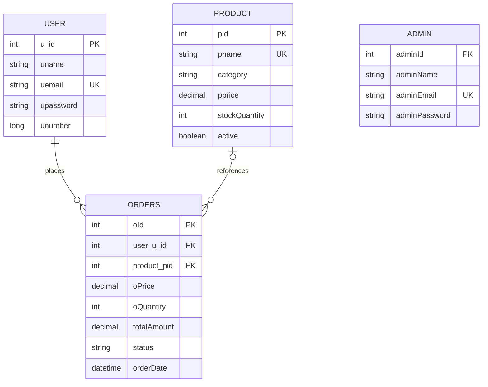

# FoodFrenzy

FoodFrenzy is a restaurant menu, ordering, and management application built as a full-stack college project. Customers can register, browse a live menu, place orders, and track order progress. Administrators can manage menu items and stock, customer accounts, team access, and order status.

## Features

- Customer registration and sign-in with BCrypt password hashing.
- Contact form that emails website enquiries to the configured inbox and sets the visitor's address as Reply-To.
- Session-based customer and administrator roles, protected routes, and CSRF protection for forms.
- Database-backed menu with categories, descriptions, images, prices, and stock counts.
- Searchable menu and customer order history.
- Server-calculated order totals and stock checks inside a database transaction.
- Order status workflow: `PLACED -> CONFIRMED -> PREPARING -> READY -> COMPLETED`; an order can be cancelled before it is ready.
- Admin dashboard for menu, customer, administrator, stock, and order management.
- Seeded starter menu and a configurable first-run demo administrator.
- Responsive Thymeleaf pages with project-owned CSS and local food imagery.

## Technology

- Java 17
- Spring Boot 3.1.3, Spring MVC, Spring Security, Spring Data JPA, Hibernate
- Thymeleaf, HTML, CSS
- MySQL
- Maven Wrapper

## Run locally

1. Install JDK 17 and start a local MySQL server.
2. From the project directory, set the database and email credentials in PowerShell:

   ```powershell
   $env:DB_USERNAME = "root"
   $env:DB_PASSWORD = "your-local-mysql-password"
   $env:MAIL_USERNAME = "t04829970@gmail.com"
   $env:CONTACT_EMAIL = "t04829970@gmail.com"
   $secureMailPassword = Read-Host "Gmail app password" -AsSecureString
   $env:MAIL_PASSWORD = [System.Net.NetworkCredential]::new("", $secureMailPassword).Password
   ```

   The default JDBC URL is `jdbc:mysql://localhost:3306/foodfrenzy?createDatabaseIfNotExist=true`. Override it with `DB_URL` if your MySQL setup differs. The contact form uses Gmail SMTP; create an app password for the sending account and keep it private. Google's app passwords require 2-Step Verification: [Google account app passwords](https://support.google.com/mail/answer/185833).

3. Start the app:

   ```powershell
   .\mvnw.cmd spring-boot:run
   ```

4. Open [http://localhost:8081](http://localhost:8081).

The app creates or updates the schema with Hibernate. On an empty database it adds the starter menu and a demo administrator. Existing menu and account records are kept; legacy menu rows receive a default category, image, and initial stock value when their new fields are empty.

Contact messages are sent to `CONTACT_EMAIL` (defaults to `t04829970@gmail.com`). Gmail SMTP uses `MAIL_USERNAME` and `MAIL_PASSWORD`; `MAIL_HOST` and `MAIL_PORT` default to `smtp.gmail.com` and `587`. Without a valid app password, the contact form displays a send error and the visitor can still use the direct `mailto:` address.

### Demo administrator

- Email: `admin@foodfrenzy.local`
- Password: `Admin@123`

Set `DEMO_ADMIN_EMAIL` and `DEMO_ADMIN_PASSWORD` before the first run to choose different demo credentials. The demo administrator is only created when that email is not already present; an existing account is never reset automatically. Customers create their own accounts from the **Create a customer account** link on the sign-in page.

## Main routes

| Route | Purpose | Access |
| --- | --- | --- |
| `/home` | Home page | Public |
| `/products` | Current menu | Public |
| `/register` | Customer registration | Public |
| `/login` | Customer/admin sign-in | Public |
| `/product/orders` | Customer order history | Customer |
| `/product/order` | Place an order | Customer |
| `/admin/services` | Management dashboard | Administrator |

## Project layout

```text
src/main/java/com/example/demo/
|-- config/           # CSRF/security setup and starter data
|-- controllers/      # MVC routes for auth, admin, products, and orders
|-- entities/         # JPA models and order status workflow
|-- loginCredentials/ # Login and order form objects
|-- repositories/     # Spring Data database access
`-- services/         # Authentication, catalog, and order business logic

src/main/resources/
|-- templates/        # Thymeleaf pages
|-- static/css/       # Responsive page styles
|-- static/Images/    # Menu and brand images
`-- application.properties
```

## Data model overview

- A customer can have many orders.
- Each order stores a customer, an optional product reference, a price snapshot, quantity, total, timestamp, and status.
- Products store category, price, image path, availability, and stock quantity. Hiding a product keeps past order records intact.
- Passwords are encoded before saving. Existing plain-text passwords from an earlier project database are upgraded to BCrypt after a successful sign-in.



## Notes for a project presentation

The order flow is a useful place to explain the layers: the controller receives a product ID and quantity, the service reloads the trusted price, checks stock under a database lock, writes the order and decrements inventory in one transaction, then the repository persists the result. The MVC views show the same data to the customer and administrator with role-specific access.

This is an educational ordering demo. It does not connect to a payment provider, delivery service, or production restaurant system.
